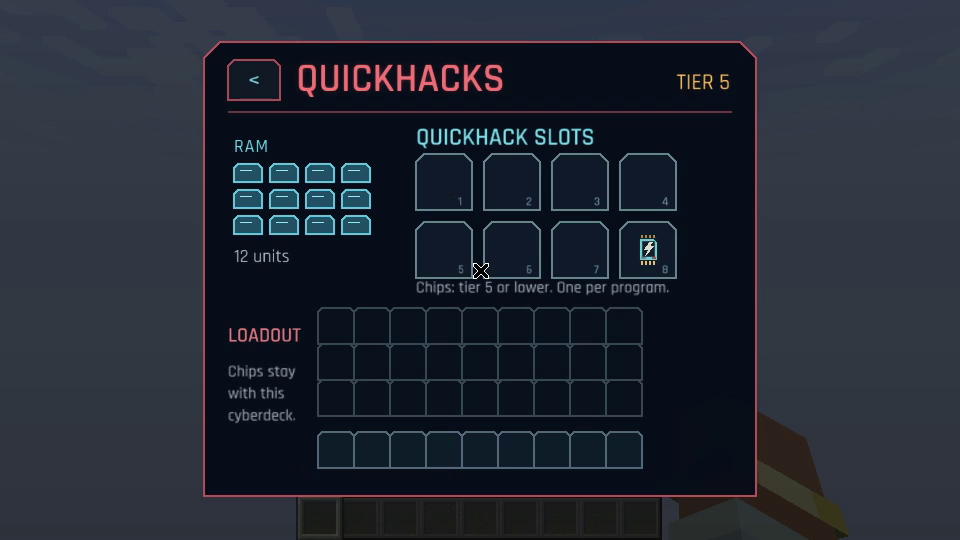

# Militech Paraline

[Wiki home](index.md) · [Cyberware](cyberware.md) · [Quickhacks](quickhacks.md) · [Village services](ripperdocs.md)

| System | Tiers | Capacity |
| --- | --- | --- |
| Operating System | 1–5 | 8 / 12 / 16 / 20 / 24 |

A general-purpose cyberdeck with a larger RAM pool and increasing direct quickhack damage.

| Tier | Capacity | RAM | Program slots | RAM/s | Queue | Base upload | Damage bonus |
| --- | ---: | ---: | ---: | ---: | ---: | --- | --- |
| 1 | 8 | 4 | 2 | 0.2 | 2 | 1.0 s | — |
| 2 | 12 | 6 | 3 | 0.3 | 2 | 0.9 s | +5% |
| 3 | 16 | 8 | 4 | 0.4 | 3 | 0.8 s | +10% |
| 4 | 20 | 10 | 6 | 0.5 | 3 | 0.7 s | +15% |
| 5 | 24 | 12 | 8 | 0.6 | 4 | 0.6 s | +20% |

The damage bonus applies to direct quickhack hits and damage-over-time totals. [Ex-Disk](ex-disk.md) and [Memory Boost](memory-boost.md) add benefits to the equipped deck.

[Load programs](cyberdecks.md#load-programs) · [Craft and upgrade Paraline](recipes.md)

[All cyberware](cyberware.md) · [Installing implants](installation.md) · [Street Cred requirements](street-cred.md)
