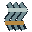

# NeoFiber

[Wiki home](index.md) · [Cyberware](cyberware.md) · [Quickhacks](quickhacks.md) · [Village services](ripperdocs.md)

| System | Tiers | Capacity |
| --- | --- | --- |
| Nervous System | 3–5 | 14 |

A chance to mitigate incoming damage. A successful mitigation reduces that hit's remaining damage. Void damage and `/kill` are excluded.

| Tier | Mitigation chance | Damage reduction on success |
| --- | --- | --- |
| 3 | 6% | 56% |
| 4 | 8% | 58% |
| 5 | 10% | 60% |

[All cyberware](cyberware.md) · [Installing implants](installation.md) · [Street Cred requirements](street-cred.md)
