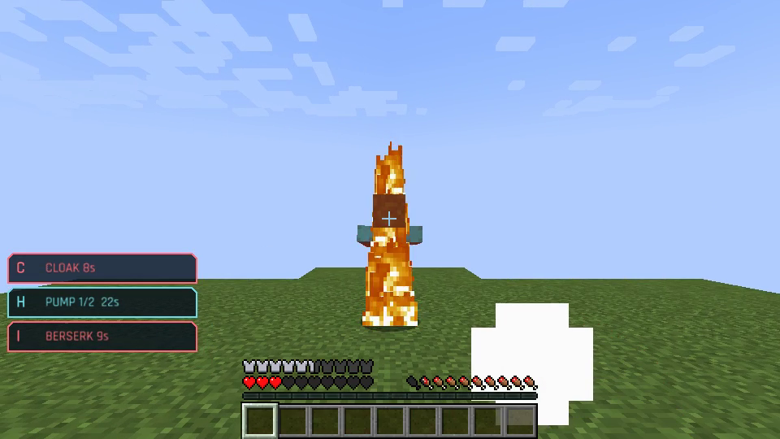

# Optical Camo

[Wiki home](index.md) · [Cyberware](cyberware.md) · [Quickhacks](quickhacks.md) · [Village services](ripperdocs.md)

| System | Tiers | Capacity |
| --- | --- | --- |
| Integumentary System | 2–5 | 16 |

Press **C** to cloak. Distant mobs drop you as their target and cannot acquire you while cloaked. Enemies within **2.5 blocks** can still detect you. Players can still attack you.

| Tier | Duration | Cooldown |
| --- | --- | --- |
| 2 | 5 s | 60 s |
| 3 | 6 s | 55 s |
| 4 | 7 s | 50 s |
| 5 | 8 s | 45 s |

The HUD shows remaining duration and cooldown. Cooldown begins on activation and persists across logout/death.

[All cyberware](cyberware.md) · [Installing implants](installation.md) · [Street Cred requirements](street-cred.md)
