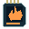
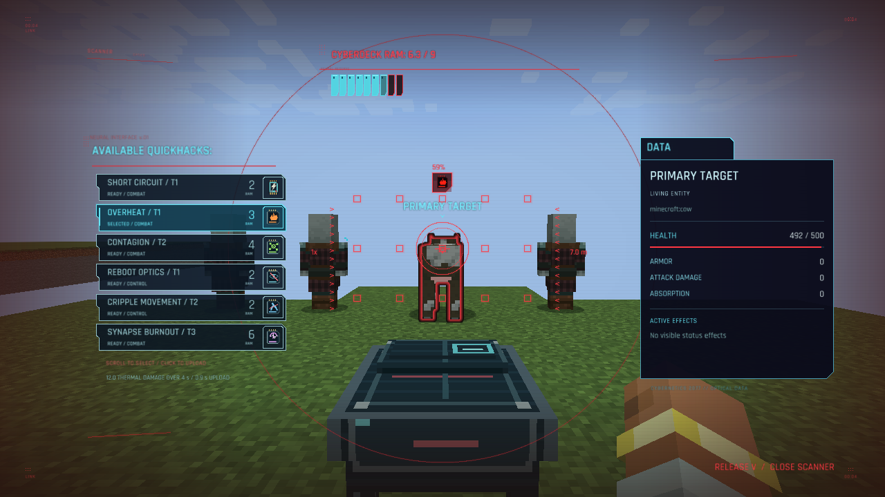

# Overheat

[Wiki home](index.md) · [Cyberware](cyberware.md) · [Quickhacks](quickhacks.md) · [Village services](ripperdocs.md)

**Tiers:** 1–5 · **Damage type:** Thermal

Deals thermal damage in **four pulses over 4 seconds**. The table lists the total base damage, not damage per pulse.

| Tier | RAM | Total base damage |
| --- | ---: | ---: |
| 1 | 3 | 12 |
| 2 | 4 | 16 |
| 3 | 5 | 20 |
| 4 | 6 | 24 |
| 5 | 7 | 28 |

Reapplying refreshes the effect instead of stacking another DOT. Fire immunity and Fire Resistance affect it.

**Combination:** Overheat consumes **tier 4 / 5 Contagion** for a **16 / 18 thermal damage** detonation. Up to three nearby enemies within 3 blocks take half that burst. The Overheat DOT continues; no terrain is destroyed.

[All quickhacks](quickhacks.md) · [Load programs](cyberdecks.md#load-programs) · [Scanning](scanning.md)
