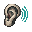

# Peripheral Inverse

[All cyberware](cyberware.md) · [Installation](installation.md) · [Daily stock](ripperdocs.md#daily-stock)

| System | Available tiers | Capacity |
| --- | --- | ---: |
| Integumentary System | 4–5 | 40 |

**Iconic:** purchase requires one matching-tier [Iconic Requisition Chip](iconics.md), full price and Street Cred.

| Tier | Effects | Price | Street Cred |
| ---: | --- | ---: | ---: |
| 4 | Up to -45% damage from attackers within 3 blocks, fading to 0% at 6 blocks. +3.2 armor / +0.8 toughness. | €$48,000 | 30 |
| 5 | Up to -45% damage from attackers within 3 blocks, fading to 0% at 6 blocks. +4.0 armor / +1.0 toughness. | €$75,000 | 40 |

[All cyberware](cyberware.md) · [Installation](installation.md) · [Daily stock](ripperdocs.md#daily-stock)
