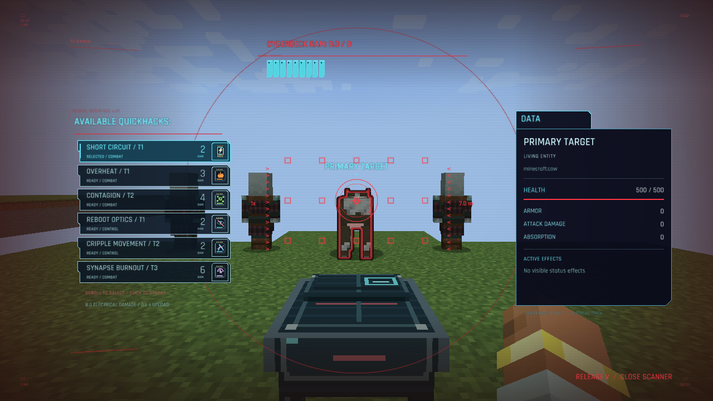

# Quickhacks

[Wiki home](index.md) · [Cyberware](cyberware.md) · [Quickhacks](quickhacks.md) · [Village services](ripperdocs.md)

Programs are chips loaded into an installed [cyberdeck](cyberdecks.md). You also need [optics](kiroshi-optics.md) to upload them.

| Program | Tiers | Damage type | Main use |
| --- | --- | --- | --- |
| [Short Circuit](short-circuit.md) | 1–5 | Electrical | Fast, direct burst |
| [Overheat](overheat.md) | 1–5 | Thermal | Damage over time; ignites high-tier Contagion |
| [Contagion](contagion.md) | 2–5 | Chemical | Spreading infection |
| [Reboot Optics](reboot-optics.md) | 1–5 | None | Blindness and target disruption |
| [Cripple Movement](cripple-movement.md) | 2–5 | None | Movement control |
| [Synapse Burnout](synapse-burnout.md) | 3–5 | Physical | Heavy burst scaling with spent RAM |

## Upload and queue

1. Load a chip using **Operating System → Manage Quickhacks**.
2. Hold **V** and aim at a visible living target.
3. **Scroll** to select an installed program, then **left-click** to upload.

RAM is reserved immediately. Different programs can share the queue, up to the deck's limit. Upload progress appears above the target's head. Removing a program or changing decks cancels affected uploads and refunds their reserved RAM, capped to current capacity.

## Damage and timing

Electrical, thermal and chemical quickhack damage bypasses armor. Physical Synapse Burnout respects armor. Fire immunity and Fire Resistance affect thermal damage. Team/PvP rules and ordinary invulnerability still apply.

The scanner displays the selected program's actual cost, damage, duration and upload time. Damage values on program pages are **base values**; deck bonuses apply to direct hits and damage-over-time totals.

| Program type | Upload time before Ex-Disk |
| --- | --- |
| Short Circuit | Deck base time |
| Overheat / Contagion | Deck base + 6 ticks |
| Reboot Optics / Cripple Movement | Half base, minimum 6 ticks |
| Synapse Burnout | Deck base + 12 ticks |

Ex-Disk then reduces the time; no upload can be shorter than 6 ticks. Twenty ticks equal one second at normal game speed.

Buy chips from [daily ripperdoc stock](ripperdocs.md#daily-stock) for **300 × tier² eddies**. New programs have no crafting recipes; Short Circuit retains its [original recipes](recipes.md).
