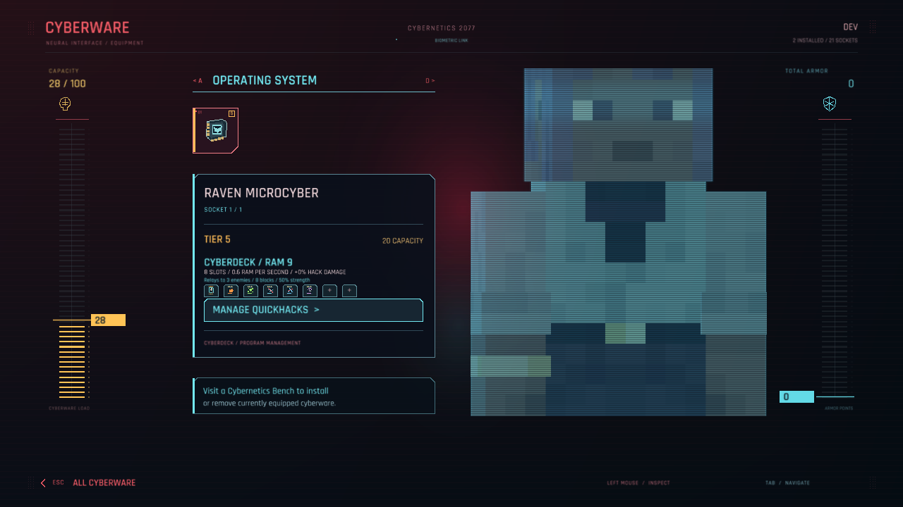

# Raven Microcyber

[Wiki home](index.md) · [Cyberware](cyberware.md) · [Quickhacks](quickhacks.md) · [Village services](ripperdocs.md)

| System | Tiers | Capacity |
| --- | --- | --- |
| Operating System | 3–5 | 16 / 18 / 20 |

A spread-focused cyberdeck. It has less base RAM than Paraline and no direct damage bonus, but relays uploaded hacks to nearby enemies.

| Tier | Capacity | RAM | Slots | RAM/s | Queue | Extra targets | Relay radius |
| --- | ---: | ---: | ---: | ---: | ---: | ---: | ---: |
| 3 | 16 | 7 | 4 | 0.4 | 3 | 1 | 4 blocks |
| 4 | 18 | 8 | 6 | 0.5 | 3 | 2 | 6 blocks |
| 5 | 20 | 9 | 8 | 0.6 | 4 | 3 | 8 blocks |

Relayed hits deal **50% damage**. Relayed control lasts **half as long**. Damage-over-time relays retain their duration at half damage. Relays occur once per upload and respect walls, teams, PvP settings and scanning range. Automatic spread targets hostile mobs and combat opponents.

**Contagion:** infection retains full damage, gains Raven's extra targets, and spreads within **16 blocks** instead of 8, up to seven secondary targets.

Buy tiers 3 / 4 / 5 from daily stock at Street Cred **20 / 30 / 40**, for **€$9,000 / 16,000 / 25,000**. Raven has no crafting recipe.

[Load programs](cyberdecks.md#load-programs) · [Contagion](contagion.md)

[All cyberware](cyberware.md) · [Installing implants](installation.md) · [Street Cred requirements](street-cred.md)
