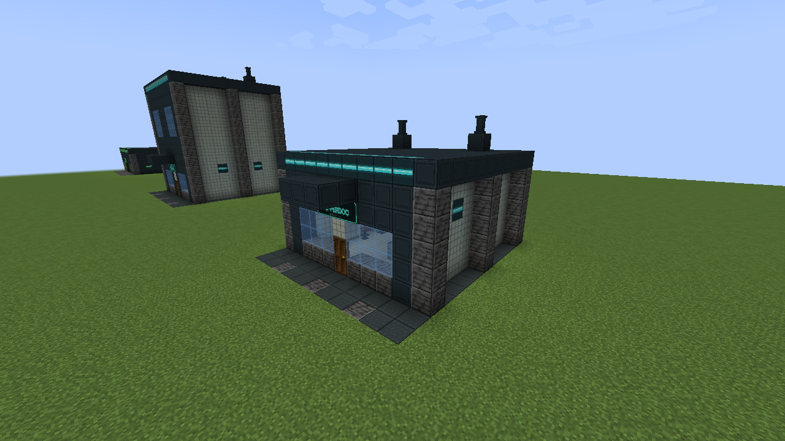
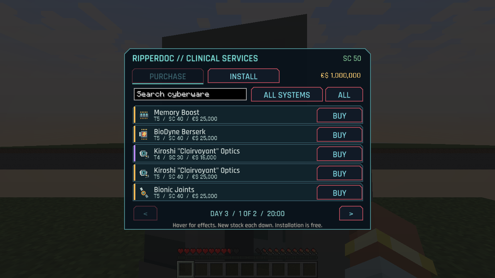

# Ripperdoc clinics

[Wiki home](index.md) · [Cyberware](cyberware.md) · [Quickhacks](quickhacks.md) · [Village services](ripperdocs.md)

Clinics can appear in newly generated **plains, desert, savanna, snowy and taiga villages**. Small clinics are common; the larger two-storey clinic is rarer. Not every village has one.

Talk to **Dr. Vale** or **Dr. Iris**:

- **Purchase:** search by name, filter by system/tier, hover to inspect, and buy with eddies. Purchases enter your inventory.
- **Install:** equip or remove implants. Shift-click is supported. Installation and removal are free.

## Daily stock

Each doctor offers **up to 10 different items per Minecraft day**. Starter selections are smaller because fewer items qualify. Stock depends on your Street Cred.

| Tier | Street Cred needed |
| --- | ---: |
| 1 | 0 |
| 2 | 10 |
| 3 | 20 |
| 4 | 30 |
| 5 | 40 |

Locked tiers are hidden. Newly unlocked tiers start uncommon and become more frequent as your reputation rises. **Tier 1 Kiroshi Optics are always available at Street Cred 0–10 inclusive.**

Stock rotates at **Overworld dawn**, every 24,000 ticks, including after sleeping. The menu shows the day and restock countdown. Reopening, unloading the clinic or restarting does not reroll it. Different doctors can carry different items; gaining Street Cred updates your assortment immediately. Buying an item does not deplete its quantity.

## Prices

| Item | Eddies |
| --- | --- |
| Ordinary implant / cyberdeck | 1,000 × tier² |
| Mantis Blades | 1,600 × tier² |
| Quickhack chip | 300 × tier² |

A full inventory, insufficient eddies, or an offer rotating out prevents purchase without payment.

## Salvage discount

Rare [cybernetically enhanced mobs](enhanced-mobs.md) drop **Tier 1–5 damaged cybernetic parts**. Choose **−30%** beside an available implant to trade **one matching-tier part plus 70% of the normal price**. Hover to see the discounted price and your part count. **BUY** keeps your parts and pays full price.

Stock and Street Cred requirements still apply. Parts work for implants and cyberdecks, not quickhack chips. Failed purchases consume neither eddies nor parts. A single part can free its inventory slot for the new implant.

[Installing cyberware](installation.md) · [Eddies and Street Cred](street-cred.md) · [First delivery](contracts.md)
