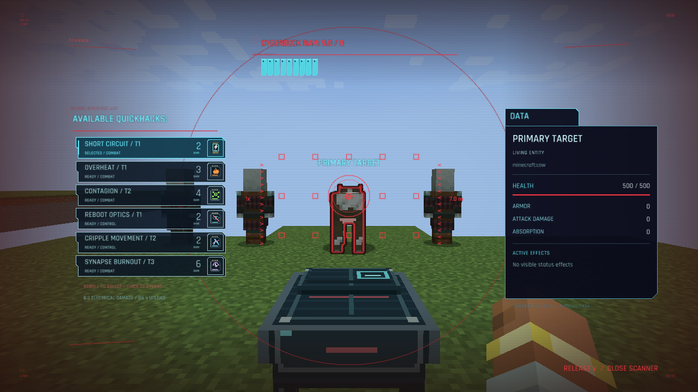

# Scanning

[Wiki home](index.md) · [Cyberware](cyberware.md) · [Quickhacks](quickhacks.md) · [Village services](ripperdocs.md)

Install **[Basic Kiroshi Optics](kiroshi-optics.md)**, **[Clairvoyant](clairvoyant-optics.md)**, **[Doomsayer](doomsayer-optics.md)** or **[Stalker Optics](stalker-optics.md)**, then hold **V**. Release V to close the scanner.

Aim at a living target with clear line of sight to see its health, armor, attack damage, absorption and visible effects. The scan range depends on the installed optics.

## With a cyberdeck

Install a [cyberdeck](cyberdecks.md), load program chips, then **scroll to select** and **left-click to queue** a hack. The scanner displays its RAM cost, damage, duration and upload time. Progress and queued icons appear above the target.

## Contract navigation

An active [delivery contract](contracts.md) provides navigation even before you own optics. Hold V for coordinates, compass direction, distance, left/right guidance and elevation. This navigation-only view does not grant target analysis or quickhacks.

[Quickhacks](quickhacks.md) · [Controls](controls.md)
