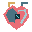
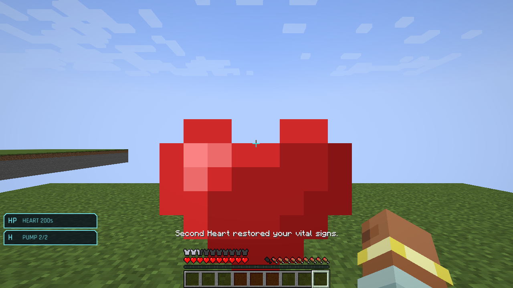

# Second Heart

[Wiki home](index.md) · [Cyberware](cyberware.md) · [Quickhacks](quickhacks.md) · [Village services](ripperdocs.md)

| System | Tiers | Capacity |
| --- | ---: | ---: |
| Circulatory System | 4–5 | 30 |

A fatal hit restores **100% maximum HP** and grants Minecraft’s normal **1-second hurt window**. Automatic; no key press. Does not protect against **the void or `/kill`**. Recharge persists through death, logout and reinstallation; see the HUD indicator. Does not refill food or RAM.

| Tier | Recharge |
| --- | ---: |
| 4 | 240 s |
| 5 | 200 s |

[All cyberware](cyberware.md) · [Installing implants](installation.md) · [Street Cred requirements](street-cred.md)

