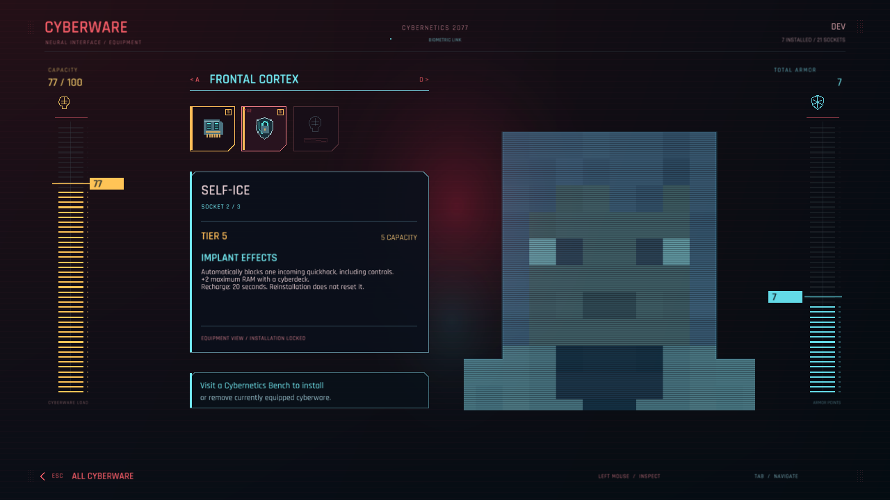

# Self-ICE

[Wiki home](index.md) · [Cyberware](cyberware.md) · [Quickhacks](quickhacks.md) · [Village services](ripperdocs.md)

| System | Tiers | Capacity |
| --- | ---: | ---: |
| Frontal Cortex | 3–5 | 5 |

Automatically neutralizes **one incoming quickhack**, including damage-over-time application and control effects. Also adds **2 maximum RAM** with a cyberdeck. No key press is needed. The attacker spends their RAM even when blocked.

The recharge persists through death, logout and reinstallation. It does not cleanse hacks that already landed, block ordinary attacks, or grant immunity during recharge. A cooldown indicator appears in the HUD.

| Tier | Recharge |
| --- | ---: |
| 3 | 32 s |
| 4 | 26 s |
| 5 | 20 s |

[All cyberware](cyberware.md) · [Installing implants](installation.md) · [Street Cred requirements](street-cred.md)

