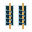

# Shock Absorber

[Wiki home](index.md) · [Cyberware](cyberware.md) · [Quickhacks](quickhacks.md) · [Village services](ripperdocs.md)

| System | Tiers | Capacity |
| --- | --- | ---: |
| Hands | 1–5 | 12 |

Reduces incoming knockback while charging a **bow, crossbow or trident**. It does not reduce damage or knockback outside that charging stance.

| Tier | Knockback reduction |
| --- | --- |
| 1 | 40% |
| 2 | 50% |
| 3 | 60% |
| 4 | 70% |
| 5 | 80% |

[All cyberware](cyberware.md) · [Installing implants](installation.md) · [Street Cred requirements](street-cred.md)
