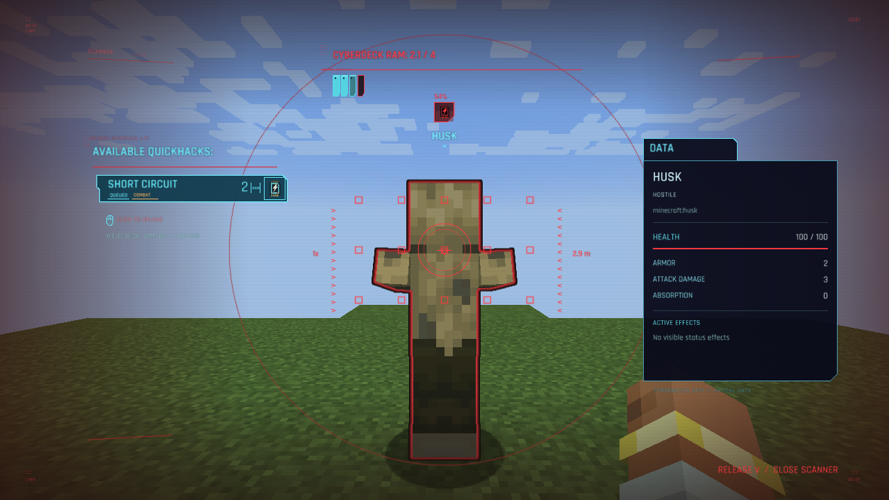

# Short Circuit

[Wiki home](index.md) · [Cyberware](cyberware.md) · [Quickhacks](quickhacks.md) · [Village services](ripperdocs.md)

**Tiers:** 1–5 · **Damage type:** Electrical

A fast electrical burst. Damage bypasses armor.

| Tier | RAM | Base damage |
| --- | ---: | ---: |
| 1 | 2 | 8 |
| 2 | 3 | 11 |
| 3 | 4 | 14 |
| 4 | 5 | 18 |
| 5 | 6 | 22 |

A tier-5 chip in tier-5 Paraline deals **26.4 electrical damage** for **6 RAM**, with a **0.6-second** upload before Ex-Disk. Raven relays deal half damage. Buy chips of the desired tier from [ripperdocs](ripperdocs.md); they have no crafting or upgrade recipes.

[All quickhacks](quickhacks.md) · [Load programs](cyberdecks.md#load-programs) · [Scanning](scanning.md)
