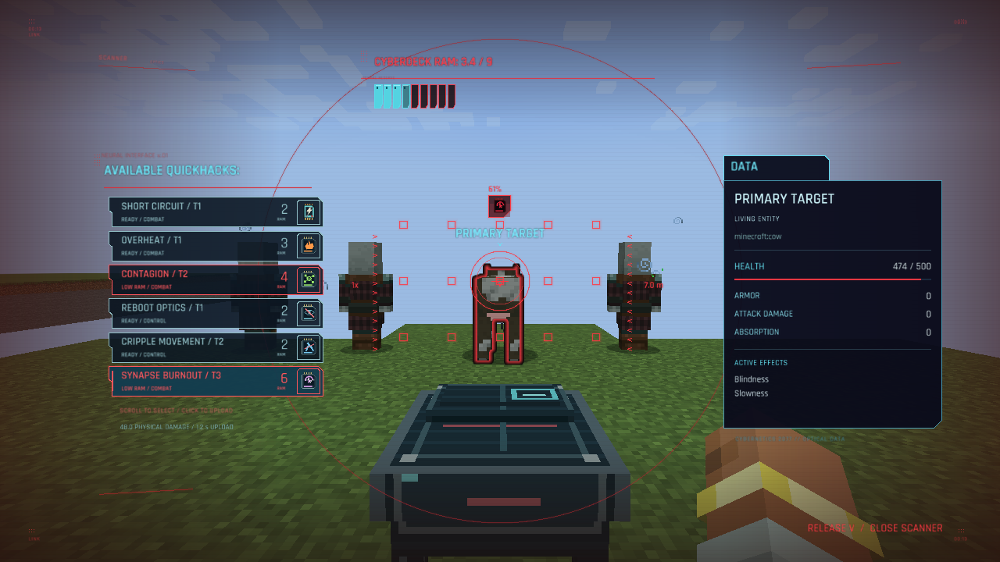

# Synapse Burnout

[Wiki home](index.md) · [Cyberware](cyberware.md) · [Quickhacks](quickhacks.md) · [Village services](ripperdocs.md)

**Tiers:** 3–5 · **Damage type:** Physical

A heavy physical burst that gets stronger as your RAM pool is spent. Physical damage respects armor.

| Tier | RAM | Base damage |
| --- | ---: | ---: |
| 3 | 6 | 24 |
| 4 | 7 | 30 |
| 5 | 8 | 36 |

Damage increases by **10% per RAM missing after paying the upload cost**, capped at **+100%**. Its own cost counts once. Damage is fixed when queued.

For example, tier-5 Synapse Burnout in a full tier-5 Paraline deals **77.76 damage before armor**: `36 × 1.2 × 1.8`. The cost is 8 RAM, and Paraline adds 20% direct damage.

[All quickhacks](quickhacks.md) · [Load programs](cyberdecks.md#load-programs) · [Scanning](scanning.md)
