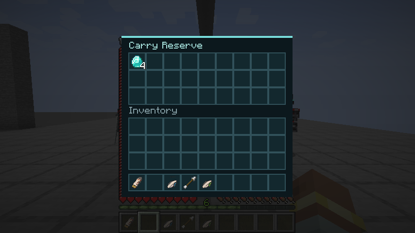

# Titanium Bones

[All cyberware](cyberware.md) · [Installation](installation.md) · [Daily stock](ripperdocs.md#daily-stock)

| System | Available tiers | Capacity |
| --- | --- | ---: |
| Skeleton | 1–5 | 6 |

| Tier | Effects | Price | Street Cred |
| ---: | --- | ---: | ---: |
| 1 | B: open a 9-slot carry reserve. Contents persist when uninstalled. +0.6 armor / +0.2 toughness. | €$1,000 | 0 |
| 2 | B: open a 9-slot carry reserve. Contents persist when uninstalled. +1.2 armor / +0.4 toughness. | €$4,000 | 10 |
| 3 | B: open a 18-slot carry reserve. Contents persist when uninstalled. +1.8 armor / +0.6 toughness. | €$9,000 | 20 |
| 4 | B: open a 18-slot carry reserve. Contents persist when uninstalled. +2.4 armor / +0.8 toughness. | €$16,000 | 30 |
| 5 | B: open a 27-slot carry reserve. Contents persist when uninstalled. +3.0 armor / +1.0 toughness. | €$25,000 | 40 |

[All cyberware](cyberware.md) · [Installation](installation.md) · [Daily stock](ripperdocs.md#daily-stock)

