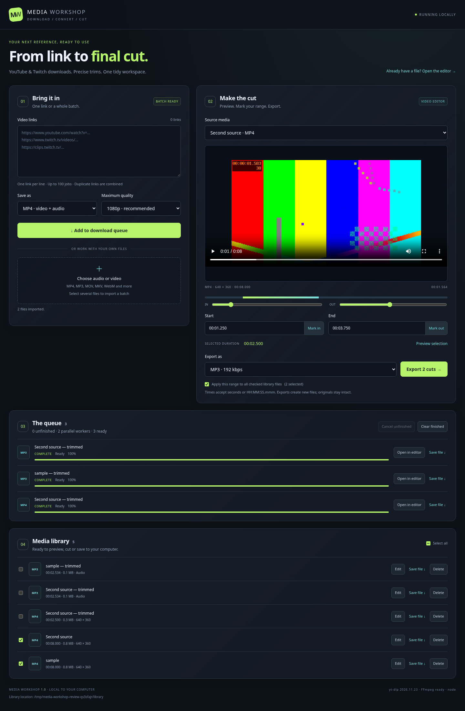

# Media Workshop

A local browser app for downloading **YouTube videos and Twitch VODs/clips** to MP4 or MP3, with a built-in preview and trimmer. Runs independently of Minecraft.



## Install and open

Requires **Python 3.11+**, **FFmpeg with ffprobe**, and **Deno or Node.js 22+** for current YouTube support. The launcher installs yt-dlp and its YouTube JavaScript components into a private `.venv` folder on first use.

**Windows**

Install these once in PowerShell (or use the linked projects' installers):

```powershell
winget install --exact --id Python.Python.3.13
winget install --exact --id Gyan.FFmpeg
winget install --exact --id DenoLand.Deno
```

Reopen your terminal after installation. Extract the program ZIP, then double-click **Start.bat**. Keep its terminal open while using the app. It opens `http://127.0.0.1:8766` in your browser.

**macOS**

With [Homebrew](https://brew.sh/):

```sh
brew install python ffmpeg deno
cd /path/to/Media-Workshop
sh start.sh
```

**Linux**

Install Python 3.11+, its `venv` module, FFmpeg and ffprobe through your package manager; install [Deno](https://docs.deno.com/runtime/getting_started/installation/) or Node.js 22+. Then run `sh start.sh` from the program folder.

The examples below use `python`; use `python3` on systems that name it that way.

Official installers: [Python](https://www.python.org/downloads/) · [FFmpeg](https://ffmpeg.org/download.html) · [Deno](https://docs.deno.com/runtime/getting_started/installation/) · [Node.js](https://nodejs.org/en/download).

## Download a batch

1. Paste one YouTube or Twitch link per line. Duplicate links in the batch are combined.
2. Choose **MP4** or **MP3**, and a maximum video quality from 480p to 4K.
3. Click **Add to download queue**. Two jobs run simultaneously by default; up to 100 unfinished jobs can be queued.
4. Use **Save file** for a browser download, or **Open in editor** to trim the result.

Each job has its own progress, cancellation and retry controls. One failed link does not stop the rest. **Cancel unfinished** stops active and waiting jobs; **Clear finished** clears history while retaining library files.

MP4 exports use H.264/AAC with fast-start playback. MP3 exports use 192 kbps. MP4 conversion re-encodes the source for consistent player compatibility, so large or 4K videos take longer. Maximum quality is a ceiling; lower-resolution sources are not upscaled.

Individual videos, Shorts, Twitch VODs and clips are supported through yt-dlp. Playlist/channel URLs are not expanded into batches, and ongoing live streams are not recorded. Site availability, authentication requirements and network restrictions can still prevent a download. This app has no login or DRM-unlocking feature.

## Trim or convert

1. Download media or choose **Choose audio or video** to import files from your computer. Multiple selection is supported.
2. Select a source, play the preview, and choose start/end times with the sliders or **Mark in / Mark out**.
3. Use **Preview selection** to play only the chosen range.
4. Choose MP4 or MP3 and click **Export cut**.

For **batch trimming**, check files in the media library, then enable **Apply this range to all checked library files**. All selected files use the same time range and output format. An invalid range or incompatible file prevents the entire batch from being queued, with an explanation. Leave End blank to use each file's own end.

Times accept seconds (`83.5`), minutes/seconds (`01:23.500`) or hours/minutes/seconds (`00:01:23.500`). Cuts are re-encoded for accurate boundaries, within the source's frame/audio-sample precision. Audio-only media exports as MP3; video with no audio cannot export as MP3. Some imported codecs cannot preview in a particular browser but can still be converted.

Original files are never overwritten. Imports are copied into the library, and each export has a separate folder. Imports stream to disk rather than loading an entire large file into memory.

## Your files and queue

The library lives in **`data/` beside app.py**; its location is also shown at the bottom of the app. Queue records and finished media survive closing and reopening. Jobs interrupted by a process crash become **Interrupted**, with a Retry button. An orderly Ctrl+C cancels unfinished jobs. Closing the browser tab leaves the app running; press **Ctrl+C in its terminal** to quit.

**Save file** makes a separate browser download. **Delete** removes a file from the app's library, leaving files saved elsewhere intact. Files with pending exports cannot be deleted. Only one app instance may open a particular library at once.

To change the library folder, parallel worker count or local port:

```sh
python launch.py gui --data-dir "D:/Media Library" --workers 3 --port 8767
```

Use `--port 0` to choose an available port or `--no-browser` to open the printed address yourself. The server listens only on your own computer; the interface loads no external fonts, scripts or analytics.

To update yt-dlp after a site changes:

```sh
python launch.py --update
```

On Windows, `Start.bat --update` works too. Install FFmpeg itself, not the unrelated Python package called `ffmpeg`.

## Command line

The same queue/encoder is available without the browser:

```sh
python launch.py download "https://youtu.be/VIDEO_ID" "https://www.twitch.tv/videos/VOD_ID" --format mp4 --height 1080
python launch.py download "https://clips.twitch.tv/CLIP_ID" --format mp3
python launch.py trim "first.mp4" "second.mp4" --start 00:00:10 --end 00:00:25.500 --format mp4
python launch.py trim "recording.mp4" --format mp3
```

Use `python app.py --help` for commands. Each command accepts `--data-dir` and `--workers`. The CLI exits nonzero if any job fails and prints the finished paths.

## Testing

```sh
python -m pip install -r requirements.txt
python -m unittest discover -s tests -v
```

Tests exercise real FFmpeg MP4/MP3 exports, batch jobs, original-file preservation, actual child-process cancellation, recovery, uploads, seeking and download responses. The real yt-dlp subprocess is exercised against a local media fixture. Public YouTube/Twitch access is a separate check; it is not simulated by those fixtures. See [VALIDATION.md](VALIDATION.md) for the observed results and platform limits.

Optional browser review (creates test media and screenshots):

```sh
python -m pip install -r requirements-dev.txt
python -m playwright install chromium
python tests/browser_review.py
```

Use `--browser /path/to/chromium` for an existing Chromium installation, or `--output /path/to/review` to change the capture directory.

Download backend: [yt-dlp](https://github.com/yt-dlp/yt-dlp) · YouTube runtime requirements: [yt-dlp EJS](https://github.com/yt-dlp/yt-dlp/wiki/EJS) · Encoding: [FFmpeg](https://ffmpeg.org/ffmpeg.html).
