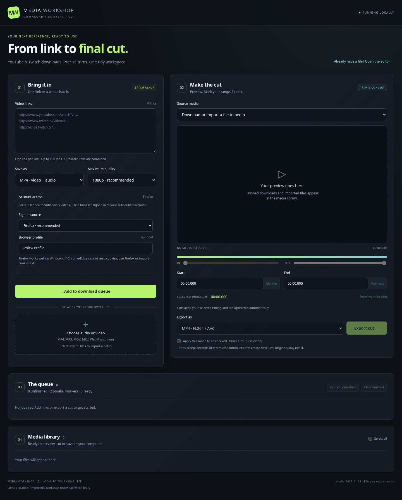
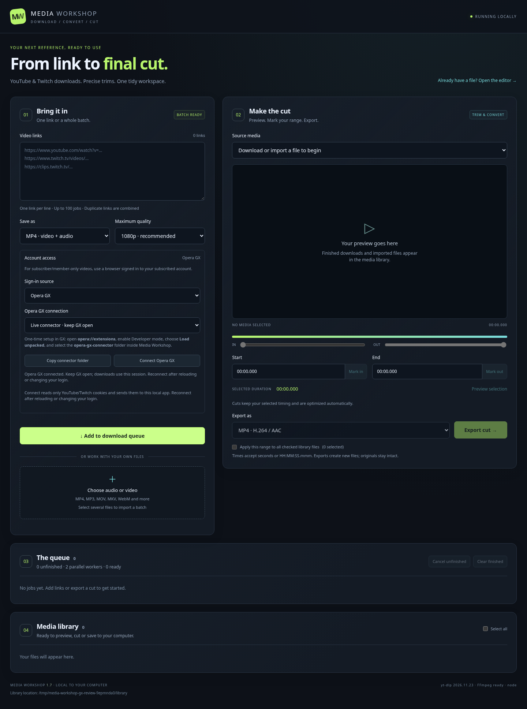

# Media Workshop

A local browser app for downloading **YouTube videos and Twitch VODs/clips** to MP4 or MP3, with a built-in preview and trimmer. Runs independently of Minecraft.


## Install and open

Requires **Python 3.11+**, **FFmpeg with ffprobe**, and **Deno or Node.js 22+** for current YouTube support. Python **3.13 is recommended**. The launcher installs the download and cut-processing dependencies into a private `.venv` folder on first use.

**Windows**

Install these once in PowerShell (or use the linked projects' installers):

```powershell
winget install --exact --id Python.Python.3.13
winget install --exact --id Gyan.FFmpeg
winget install --exact --id DenoLand.Deno
```

Reopen your terminal after installation. Extract the program ZIP, then double-click **Start.bat**. Keep its terminal open while using the app. It opens `http://127.0.0.1:8766` in your browser.

**macOS**

With [Homebrew](https://brew.sh/):

```sh
brew install python ffmpeg deno
cd /path/to/Media-Workshop
sh start.sh
```

**Linux**

Install Python 3.11+, its `venv` module, FFmpeg and ffprobe through your package manager; install [Deno](https://docs.deno.com/runtime/getting_started/installation/) or Node.js 22+. Then run `sh start.sh` from the program folder.

The examples below use `python`; use `python3` on systems that name it that way.

Official installers: [Python](https://www.python.org/downloads/) · [FFmpeg](https://ffmpeg.org/download.html) · [Deno](https://docs.deno.com/runtime/getting_started/installation/) · [Node.js](https://nodejs.org/en/download).

When updating from an older version, replace the program files and retain your **data/** folder (and **.venv/**). Existing media and queue history remain available. The launcher automatically installs changed requirements on the next start.

## Download a batch

1. Paste one YouTube or Twitch link per line. Duplicate links in the batch are combined.
2. Choose **MP4** or **MP3**, and a maximum video quality from 480p to 4K.
3. Click **Add to download queue**. Two jobs run simultaneously by default; up to 100 unfinished jobs can be queued.
4. Use **Save file** for a browser download, or **Open in editor** to trim the result.

Each job has its own progress, cancellation and retry controls. One failed link does not stop the rest. **Cancel unfinished** stops active and waiting jobs; **Clear finished** clears history while retaining library files.

MP4 downloads prefer H.264 video and AAC audio while retaining the selected resolution/frame rate. Compatible separate tracks are merged directly into a fast-start MP4, avoiding an extra MKV-to-MP4 pass. Other combinations retain a compatible intermediate container. Ready-to-use, fast-start MP4s are saved directly. Other compatible files are remuxed using **stream copy**, preserving their compressed audio and video without re-encoding. If one track is incompatible, only that track is converted. Necessary video conversions use a faster preset and a bounded CPU-thread budget shared between the configured workers.

The queue shows **Direct save**, **Stream copy**, or which tracks require conversion. Resolution still respects your quality ceiling, and sources are not upscaled. A 4K source is not replaced with a lower-resolution H.264 source just to avoid conversion.

**MP3 conversion starts during the download**, rather than waiting for the entire source to finish. Existing MP3 downloads are preserved at their source bitrate without encoding; other audio downloads are converted to **192 kbps**. For M4A/MP4 inputs, a temporary source cache is retained until decoding starts. If the input needs backward seeking, the completed download is reused for conversion instead of fetching it again. Normal streaming conversion discards the cache once it is no longer needed.

Downloads share a version-aware yt-dlp extractor cache inside the library, and use small progress reports rather than repeatedly serializing full source metadata. The queue identifies when separate tracks are being combined.

Individual videos, Shorts, Twitch VODs and clips are supported through yt-dlp. Playlist/channel URLs are not expanded into batches, and ongoing live streams are not recorded. Site availability, authentication requirements and network restrictions can still prevent a download. Account access is optional, as described below. DRM-protected media is unsupported.

## Subscriber/member-only videos and clips



1. Sign into YouTube or Twitch in a browser on **the same computer** and check that your account can play the video.
2. Expand **Account access** in the downloader. Select that browser; **Firefox is recommended**, especially on Windows. If needed, enter its profile name or full profile-folder path.
3. Paste the link, choose MP4 or MP3, and queue it as usual. The account selection applies to every link in the batch. No password is entered in Media Workshop.

If browser-cookie extraction fails, close the browser and retry. Chrome/Edge's cookie protection can still prevent extraction on Windows; use a signed-in Firefox profile, or choose **Import cookies.txt** and select a Netscape-format cookie export from your signed-in browser. Export only the relevant site's cookies using a tool you trust. The file contains account credentials: keep it on your computer and never post it in chat or GitHub.

Imported cookies are held in memory until the app quits. Each active download gets a separate temporary cookie file, removed on success, failure or cancellation; startup removes leftovers from interrupted jobs. Cookie contents are not saved in queue history, and authenticated downloads do not use the shared extractor cache. Temporary files use owner-only permissions on Unix; on Windows they inherit your library folder's access controls. These files are not encrypted. The original exported file remains yours to delete.

Browser/profile preferences are remembered locally; imported cookie contents are not stored in browser storage. After quitting the app, import the file again before retrying an interrupted cookie-authenticated download. You can also change **Account access** before clicking **Retry** to replace a failed job's sign-in. Leave **Public videos** selected when no sign-in is needed.

This uses the access your account already has. Availability still depends on yt-dlp/site support, an active subscription, and valid cookies; it does not unlock videos your account cannot view. Real subscriber-account access has not been tested in this development environment.

### Opera GX: keep the browser open

**Opera GX → Live connector** uses GX's own extension API instead of copying the locked cookie database. This is the recommended GX option. It needs a one-time extension setup:

1. Extract the **entire** updated program ZIP and start Media Workshop.
2. In GX, open **opera://extensions**, enable **Developer mode**, and click **Load unpacked**.
3. Select the **opera-gx-connector** folder inside the extracted program. The app's **Copy connector folder** button gives its full location. Allow the connector's YouTube/Twitch site access.
4. Open or reload Media Workshop **in GX**, choose **Account access → Opera GX → Live connector**, and click **Connect Opera GX**. Sign into the site in that same GX profile first.
5. Queue your links or click **Retry** on the old failed download. GX can stay open.



No cookie export file is created. The connector reads only YouTube/Twitch cookies, only on an actual Connect click, and sends them directly to the local app's protected import endpoint. It stores no credentials and does not contact an external service. Reconnect after reloading the app, restarting it, or changing your login. Native Opera GX/Windows execution remains unverified here; see [validation](VALIDATION.md#opera-gx-support).

**Direct profile** is the alternative if you prefer no extension: GX's separate Windows/macOS profile location is detected automatically, with an optional full-path override from **opera://about → Profile**. Fully exit GX before downloading this way. Locked or protected databases produce specific guidance to use the live connector; the app does not terminate GX, change browser security or request administrator access. [Connector setup and permissions](opera-gx-connector/README.md).

## Trim or convert

1. Download media or choose **Choose audio or video** to import files from your computer. Multiple selection is supported.
2. Select a source, play the preview, and choose start/end times with the sliders or **Mark in / Mark out**.
3. Use **Preview selection** to play only the chosen range.
4. Select MP4 or MP3 and click **Export cut**.

There is **one accurate cut workflow**, optimized automatically. Version 1.4.1 fixes false full-encoding fallbacks when audio extends past the end of the video track. Your selected start/end times stay in place, within the source's frame/audio-sample precision.

- Compatible H.264 cuts copy complete video sections and re-encode only the boundaries. Compatible AAC audio is copied with precise start timing; other audio is converted alongside the video work.
- Very short cuts and other codecs use a fast accurate encoder automatically. If boundary processing cannot preserve the requested timing, the app uses that encoder instead.
- Exporting the whole source copies compatible tracks when possible. Originals remain intact.
- MP3 cuts are encoded at 192 kbps to retain precise timing without compressed-frame cut shifts.

Boundary processing uses smartcut on Python 3.11–3.14; other supported Python versions retain the accurate FFmpeg path. Processing seeks directly to the selected range instead of copying a temporary video or scanning the beginning of a long source. Performance depends on the codec, resolution, keyframe spacing and selected range. The queue shows when full encoding is required. Faster encoding can produce larger files than slower presets.

For **batch trimming**, check files in the media library, then enable **Apply this range to all checked library files**. All selected files use the same time range and output format. An invalid range or incompatible file prevents the entire batch from being queued, with an explanation. Leave End blank to use each file's own end.

AAC exports can retain up to one compressed audio frame at the end (normally about 21–23 ms); video timing follows the source frames. Times accept seconds (`83.5`), minutes/seconds (`01:23.500`) or hours/minutes/seconds (`00:01:23.500`). Audio-only media exports as MP3; video with no audio cannot export as MP3. Some imported codecs cannot preview in a particular browser but can still be converted.

Original files are never overwritten. Imports are copied into the library, and each export has a separate folder. Imports stream to disk rather than loading an entire large file into memory.

## Your files and queue

If a cut shows **Encoding MP4 (compatibility fallback)**, expand **Why this cut is encoding** in that queue entry and use **Copy details**. This shows the actual boundary-processing error; new failures also include codec, resolution and dependency versions. The explanation remains available after completion. Existing saved failures can be inspected without repeating the cut. On older versions, the same error is saved as `fallback_reason` in `data/library.json`. A fallback means the selected clip is being fully encoded to preserve timing; the status alone does not identify its cause.

The library lives in **`data/` beside app.py**; its location is also shown at the bottom of the app. Queue records and finished media survive closing and reopening. Jobs interrupted by a process crash become **Interrupted**, with a Retry button. An orderly Ctrl+C cancels unfinished jobs. Closing the browser tab leaves the app running; press **Ctrl+C in its terminal** to quit.

**Save file** makes a separate browser download. **Delete** removes a file from the app's library, leaving files saved elsewhere intact. Files with pending exports cannot be deleted. Only one app instance may open a particular library at once.

To change the library folder, parallel worker count or local port:

```sh
python launch.py gui --data-dir "D:/Media Library" --workers 3 --port 8767
```

Use `--port 0` to choose an available port or `--no-browser` to open the printed address yourself. The server listens only on your own computer; the interface loads no external fonts, scripts or analytics.

To update yt-dlp after a site changes:

```sh
python launch.py --update
```

On Windows, `Start.bat --update` works too. Install FFmpeg itself, not the unrelated Python package called `ffmpeg`.

## Command line

The same queue/encoder is available without the browser:

```sh
python launch.py download "https://youtu.be/VIDEO_ID" "https://www.twitch.tv/videos/VOD_ID" --format mp4 --height 1080
python launch.py download "https://clips.twitch.tv/CLIP_ID" --format mp3
python launch.py download "https://www.twitch.tv/videos/VOD_ID" --format mp4 --browser firefox
python launch.py download "https://www.twitch.tv/videos/VOD_ID" --format mp4 --browser opera-gx
python launch.py download "https://youtu.be/VIDEO_ID" --format mp3 --browser firefox --browser-profile "Personal"
python launch.py download "https://clips.twitch.tv/CLIP_ID" --format mp4 --cookies "cookies.txt"
python launch.py trim "first.mp4" "second.mp4" --start 00:00:10 --end 00:00:25.500 --format mp4
python launch.py trim "recording.mp4" --start 10.250 --end 25.500 --format mp4
python launch.py trim "recording.mp4" --format mp3
```

The CLI `--browser opera-gx` uses direct profile access and requires GX to be closed. Use the browser interface for the live connector.

Use `python app.py --help` for commands. Each command accepts `--data-dir` and `--workers`. The CLI uses the same automatic accurate workflow, prints the cut start and output duration, and exits nonzero if any job fails. Old saved cut-mode settings are ignored.

## Testing

```sh
python -m pip install -r requirements.txt
python -m unittest discover -s tests -v
```

Tests exercise real FFmpeg MP4/MP3 exports, batch jobs, original-file preservation, actual child-process cancellation, recovery, uploads, seeking and download responses. The real yt-dlp subprocess is exercised against a local media fixture. Public YouTube/Twitch access is a separate check; it is not simulated by those fixtures. See [VALIDATION.md](VALIDATION.md) for the observed results and platform limits.

Optional browser review (creates test media and screenshots):

```sh
python -m pip install -r requirements-dev.txt
python -m playwright install chromium
python tests/browser_review.py
```

Use `--browser /path/to/chromium` for an existing Chromium installation, or `--output /path/to/review` to change the capture directory.

GX connector review in a fresh profile with synthetic cookies:

```sh
python tests/opera_gx_review.py --browser /path/to/chromium
```

If browser policy blocks unpacked extensions, `--fixture` explicitly tests the actual content script in an isolated world with a simulated extension/runtime API. This checks the local import/UI path, not native extension loading or cookie extraction. The default review never silently switches to simulation.

Download backend: [yt-dlp](https://github.com/yt-dlp/yt-dlp) · YouTube runtime requirements: [yt-dlp EJS](https://github.com/yt-dlp/yt-dlp/wiki/EJS) · Encoding: [FFmpeg](https://ffmpeg.org/ffmpeg.html) · Boundary processing: [smartcut](https://github.com/skeskinen/smartcut) by Santtu Keskinen ([MIT license](https://github.com/skeskinen/smartcut/blob/main/LICENSE)) using [PyAV](https://pyav.org/). Dependencies are installed separately; their source and binaries are not bundled in the ZIP.
